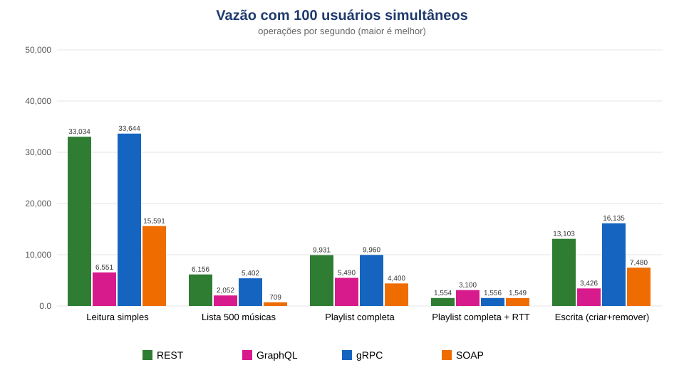
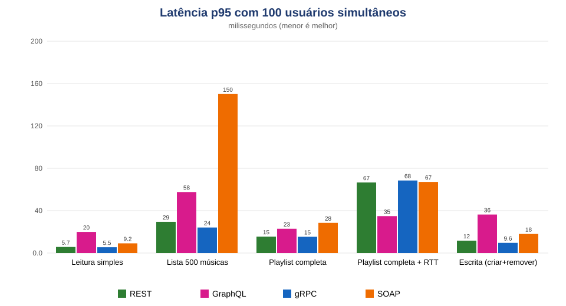
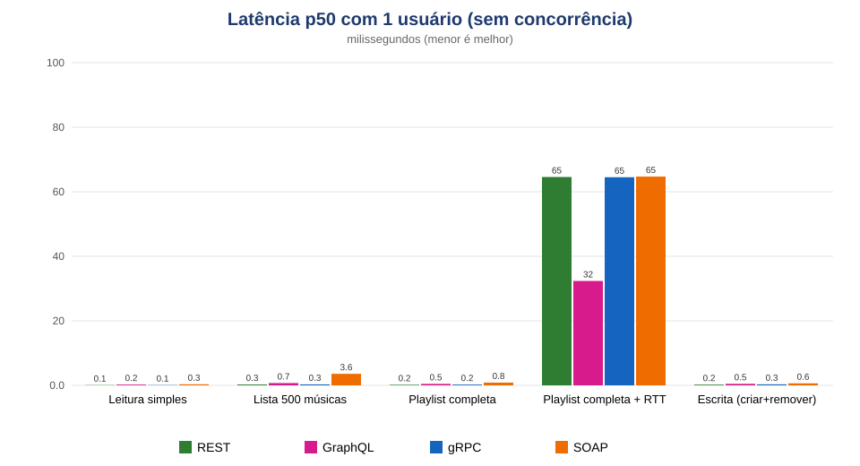
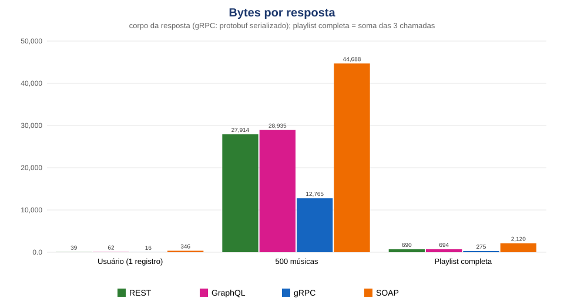
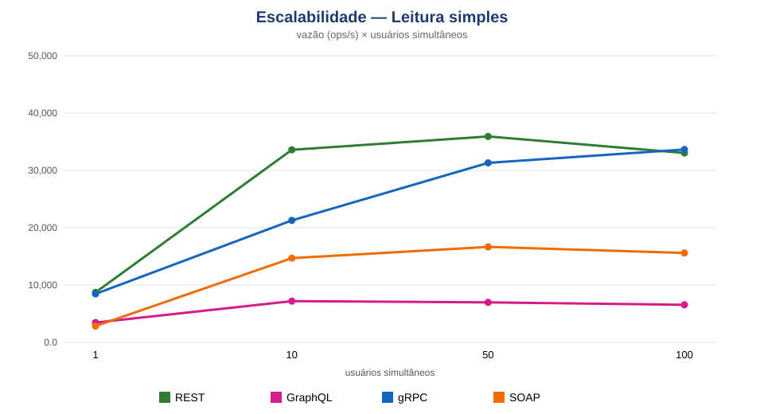
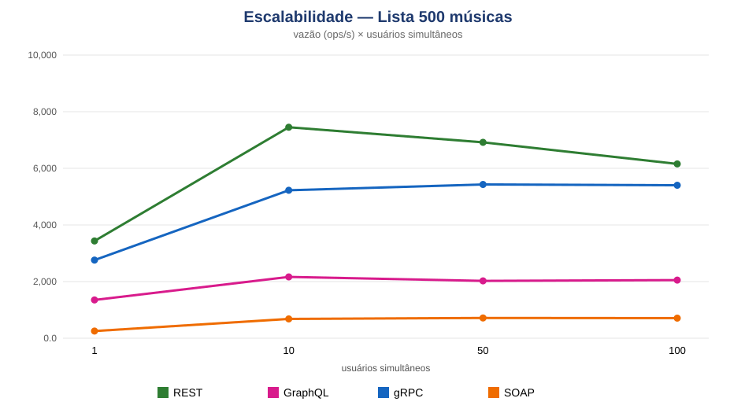
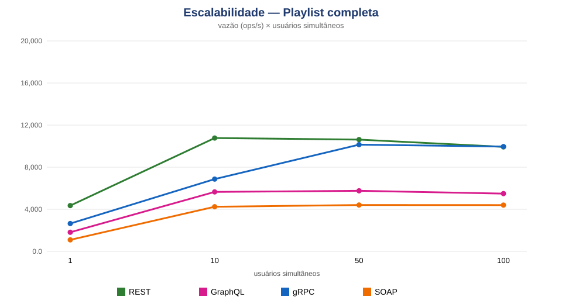
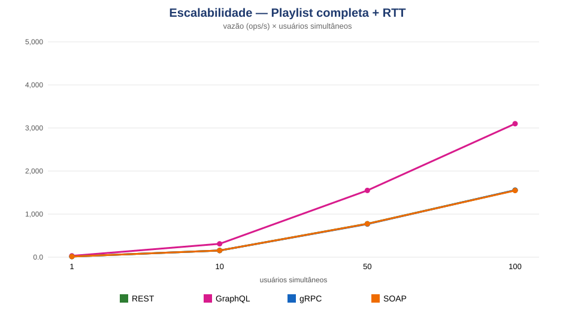
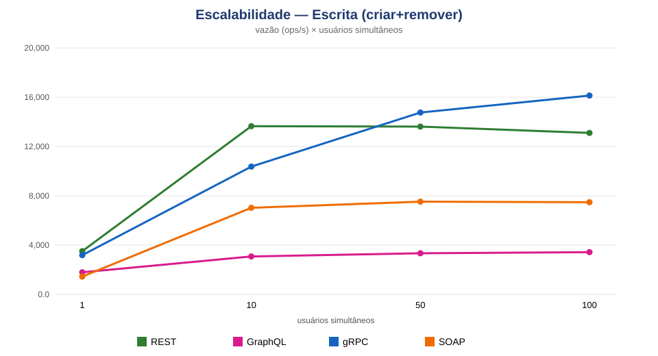

# Trabalho 6 — Comparação de Tecnologias de Invocação de Serviços Remotos

Computação Distribuída — Prof. Nabor C. Mendonça

**Integrantes**
- Sofya Emilly Oliveira Sousa — 2320314
- Pedro Vitor Medeiros Holanda Pequeno — 2315091
- Ricardo Filho Sobral Monteiro Ramos — 2310365

Serviço de streaming de músicas (usuários, músicas e playlists, com CRUD e consultas relacionais) implementado em **Node.js** com **REST**, **GraphQL**, **gRPC** e **SOAP**, sobre a mesma regra de negócio (`src/store.js`), mais testes de carga comparando as quatro tecnologias. A apresentação está em [`Trabalho6-Comparacao-Servicos-Remotos.pptx`](Trabalho6-Comparacao-Servicos-Remotos.pptx).

## Como rodar

```bash
npm install
node src/gerar-wsdl.js        # (opcional) regenera wsdl/streaming.wsdl
node src/start-all.js         # REST :3001, GraphQL :3002/graphql, gRPC :3003, SOAP :3004/soap?wsdl
node src/testes.js            # teste funcional idêntico nas 4 APIs (com as APIs no ar)
node loadtest/run.js          # testes de carga (~13 min) -> results/resultados.json
node loadtest/payload.js      # bytes por resposta -> results/payload.json
node loadtest/graficos.js     # gráficos SVG, CSV e tabelas
node loadtest/slides.js       # regenera o .pptx
```

## Estrutura

| Caminho | Conteúdo |
|---|---|
| `src/store.js` | domínio compartilhado (regras, validações, cascata) |
| `src/rest.js`, `graphql.js`, `grpc.js`, `soap.js` | as 4 APIs |
| `proto/streaming.proto`, `wsdl/streaming.wsdl` | contratos gRPC e SOAP |
| `src/clientes.js` | clientes das 4 tecnologias com a mesma interface |
| `loadtest/` | gerador de carga, medição de payload, gráficos e slides |
| `results/` | dados brutos (JSON/CSV/log), tabelas e gráficos |

## Metodologia dos testes de carga

- Windows 11, 14 núcleos, servidores Node.js 26 em processo único, tudo em localhost.
- Gerador de carga em `worker_threads` (até 4), loop fechado: N usuários virtuais disparam operações sem pausa.
- Clientes idiomáticos (fetch, `@grpc/grpc-js`, cliente `soap`); 2 s de aquecimento + 8 s medidos por combinação.
- Concorrência: 1, 10, 50 e 100 usuários. 5 cargas × 4 concorrências × 4 tecnologias = 80 execuções, **0 erros**.
- Cargas: leitura de 1 usuário; listagem de 500 músicas; playlist completa (playlist + músicas + dono: 3 chamadas em REST/gRPC/SOAP, 1 em GraphQL); a mesma com RTT simulado (~30 ms efetivos por chamada, resolução do timer do Windows); escrita (criar + remover usuário).
- Limitações: cliente e servidor dividem a CPU; os resultados valem para Node.js, não para as tecnologias em abstrato.

## Resultados

### Vazão (ops/s) com 100 usuários

| Carga | REST | GraphQL | gRPC | SOAP |
|---|---:|---:|---:|---:|
| Leitura simples | 33,034 | 6,551 | 33,644 | 15,591 |
| Lista 500 músicas | 6,156 | 2,052 | 5,402 | 709 |
| Playlist completa | 9,931 | 5,490 | 9,960 | 4,400 |
| Playlist completa + RTT | 1,554 | 3,100 | 1,556 | 1,549 |
| Escrita (criar+remover) | 13,103 | 3,426 | 16,135 | 7,480 |

### Latência p95 (ms) com 100 usuários

| Carga | REST | GraphQL | gRPC | SOAP |
|---|---:|---:|---:|---:|
| Leitura simples | 5.7 | 20 | 5.5 | 9.2 |
| Lista 500 músicas | 29 | 58 | 24 | 150 |
| Playlist completa | 15 | 23 | 15 | 28 |
| Playlist completa + RTT | 67 | 35 | 68 | 67 |
| Escrita (criar+remover) | 12 | 36 | 9.6 | 18 |

### Latência p50 (ms) com 1 usuário

| Carga | REST | GraphQL | gRPC | SOAP |
|---|---:|---:|---:|---:|
| Leitura simples | 0.1 | 0.2 | 0.1 | 0.3 |
| Lista 500 músicas | 0.3 | 0.7 | 0.3 | 3.6 |
| Playlist completa | 0.2 | 0.5 | 0.2 | 0.8 |
| Playlist completa + RTT | 65 | 32 | 65 | 65 |
| Escrita (criar+remover) | 0.2 | 0.5 | 0.3 | 0.6 |

### Gráficos






Escalabilidade (vazão × usuários simultâneos):







Latência p95 por carga: [leitura](results/graficos/latencia-p95-leitura.svg) · [lista](results/graficos/latencia-p95-lista.svg) · [playlist completa](results/graficos/latencia-p95-composta.svg) · [com RTT](results/graficos/latencia-p95-composta_rtt.svg) · [escrita](results/graficos/latencia-p95-escrita.svg)

### Principais conclusões

- **REST ≈ gRPC** em vazão no Node.js; gRPC tem payload ~2× menor e foi o melhor em escrita.
- **SOAP** foi de ~1,7× a ~9× mais lento que REST, principalmente com payloads grandes (o XML da lista de 500 músicas é ~1,6× o JSON, e um único usuário ocupa 346 bytes contra 39).
- **GraphQL** foi mais lento por requisição (~1,8× a ~5×), mas faz 1 viagem em vez de 3: com latência de rede simulada, teve metade da latência e o dobro da vazão na playlist completa.

Dados brutos: [`results/resultados.csv`](results/resultados.csv), [`results/resultados.json`](results/resultados.json), [`results/payload.json`](results/payload.json), [`results/carga.log`](results/carga.log).
